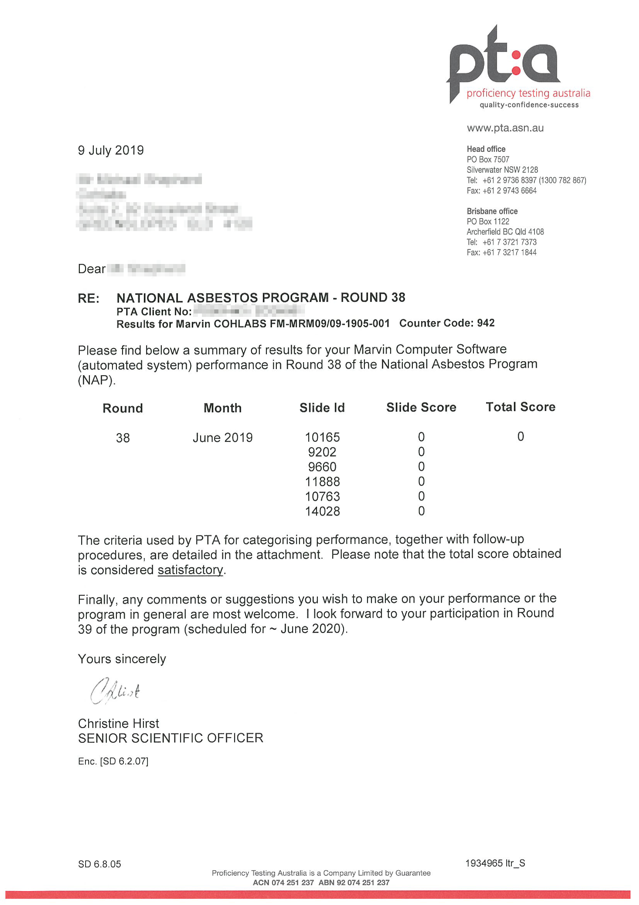
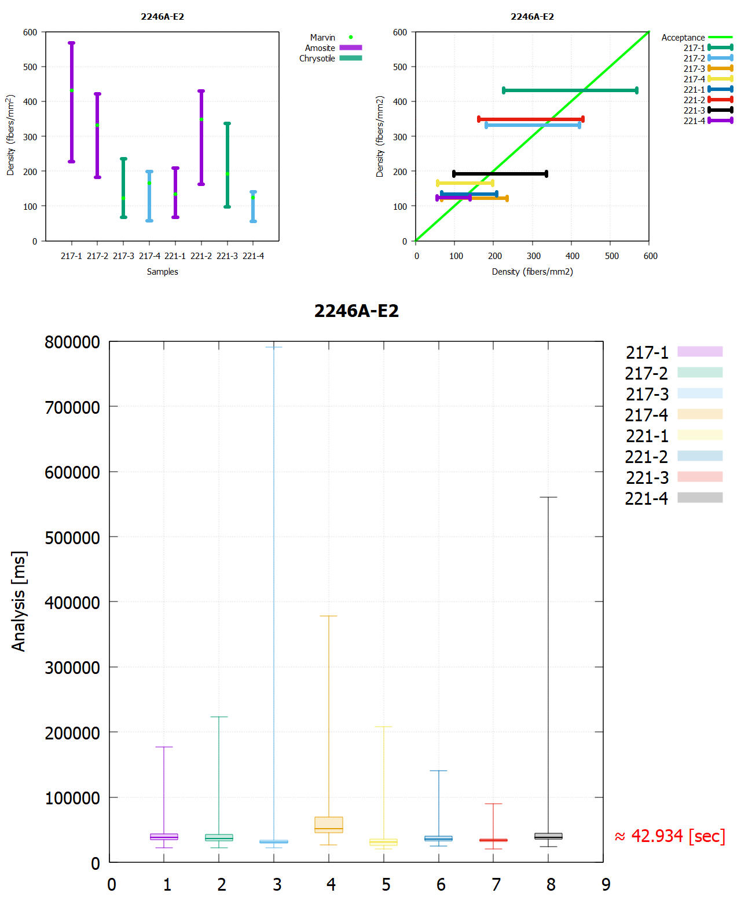
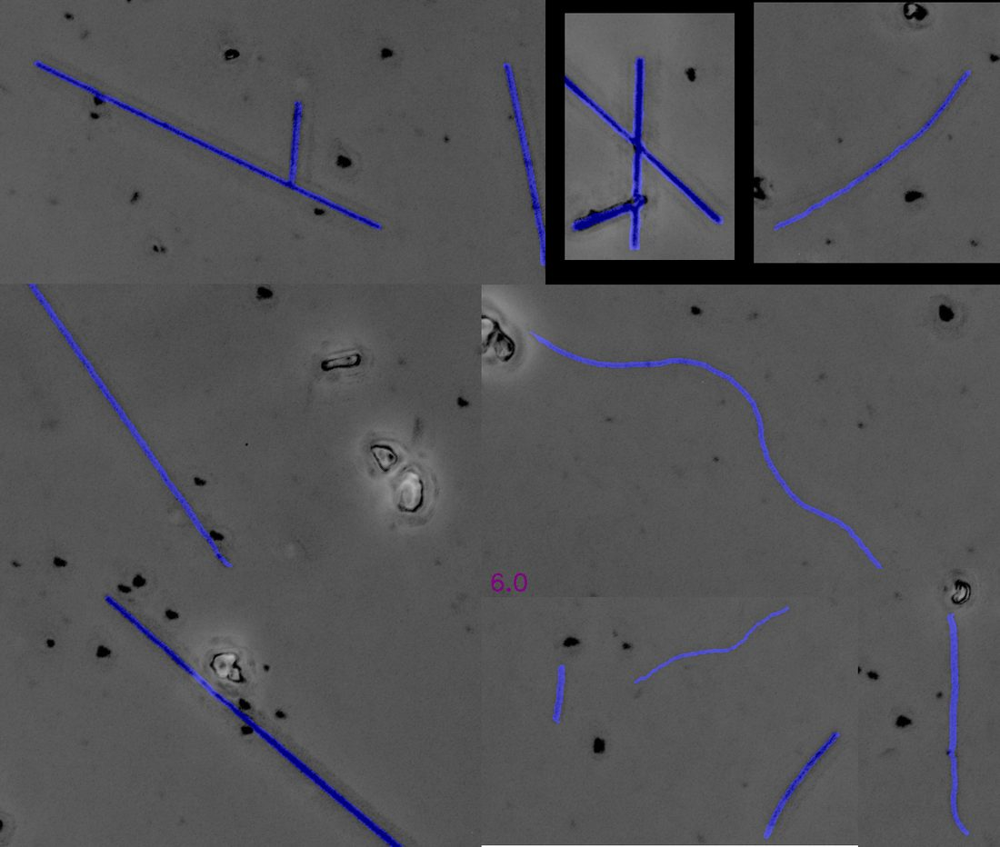

# Frontier Microscopy — automated asbestos-counting system: 2019 proficiency-test result

Marvin Computer Software entered National Asbestos Program (NAP) round #38 as an automated
system under counter code 942. NAP is the Australian inter-laboratory proficiency scheme used by
NATA-accredited asbestos fibre counters.

All six slides scored 0 (satisfactory, within innerlimits) → Total Score 0, the best possible outcome.

<small>Name of the cooperating laboratory is redacted.</small>

**The scores for individual slides are:**
- 0 if the count is satisfactory (between inner limits)
- 1 if the count is marginal (i.e. between inner and outer limits)
- 2 if the count is extreme (i.e. outside the outer limits)

A total score of 0–2 is satisfactory, 3 questionable, 4+ unsatisfactory.

Model performance (2246A-E2)

Example instance-counting output:

